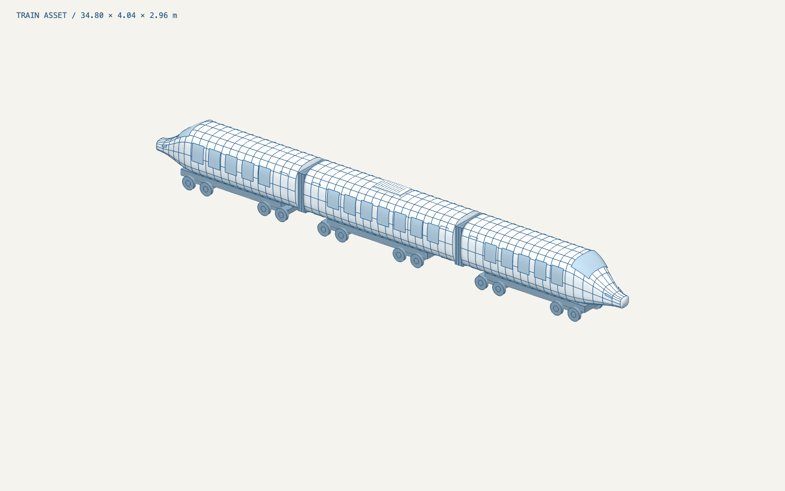

# Landing-page train

`high-speed-train.glb` is an original procedural, stylised high-speed train created for this project.
It uses no third-party model, logos, textures, or manufacturer-specific geometry.



- Three cars: two streamlined power cars and a central passenger carriage.
- Blue body surfaces, pale contour lines, windows, windscreens, doors, gangways, bogies and wheels.
- X runs along the train, Y is up; the ground is Y = 0 and the train is centred along X and Z.
- Approximately 35 metres long. Proportions are illustrative, not engineering measurements.
- Named meshes allow later material overrides. No camera, lighting, track or animation is baked in.
- GLB includes line primitives; keep them when importing to preserve the blueprint style.

Edit `components/train/create-train.ts` for geometry and the `--train-*` hex tokens in
`app/globals.css` for materials, then regenerate inside Docker:

```sh
docker compose exec web node --experimental-strip-types scripts/export-train.mjs
```

`components/train/train-model.tsx` provides `<TrainModel />` for use inside a client-only
React Three Fiber `<Canvas>` with a Suspense boundary. Add camera, lighting, loading/error
fallbacks and rotation in the containing scene. Each instance clones the hierarchy while
sharing cached geometry and materials.
